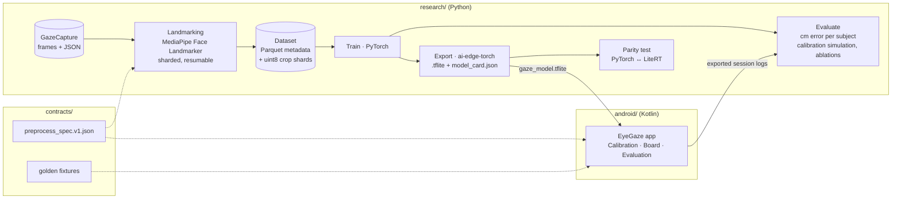
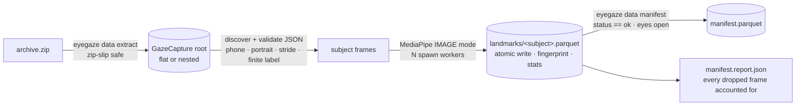
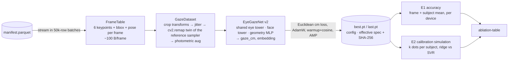
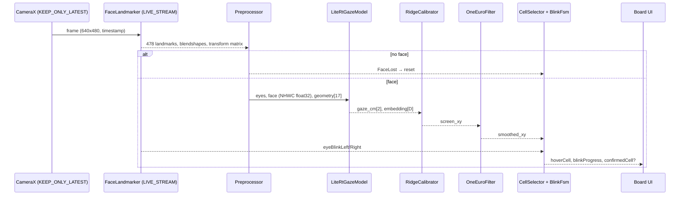
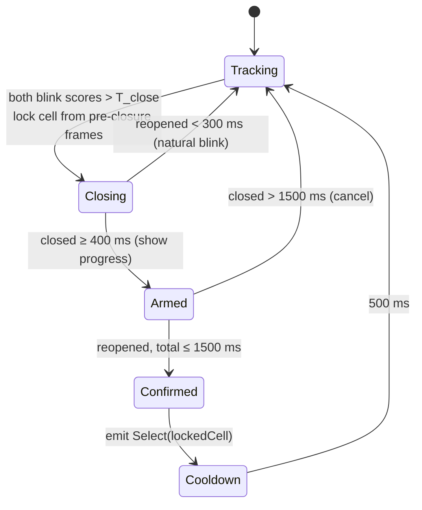
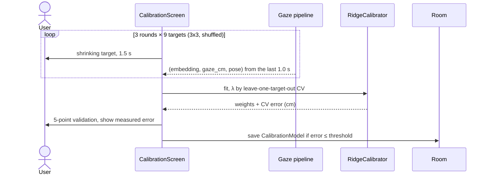

# Architecture

EyeGaze turns a phone's front camera into a gaze pointer: **look at a cell to select it, blink to confirm**.
Everything runs on-device. Design decisions are recorded in [`adr/`](adr/).

## System overview

## Research package layers (`research/src/eyegaze`)

| Layer | Contents | Rules |
|---|---|---|
| `domain/` | `spec`, `observation` (landmarks, head pose), `preprocess` (reference crop sampler), `features`, `geometry` (cm ↔ screen), `calibration` (ridge + LOO-target CV), `metrics` | numpy + stdlib only, no I/O, `mypy --strict` |
| `application/` | use cases: build dataset, train, evaluate, export; `ports.py` protocols | depends on domain + ports; dataset use cases also use the GazeCapture/landmark-store adapters directly, since those *are* the data format |
| `adapters/` | GazeCapture reader, MediaPipe landmarker, shard storage, PyTorch model, LiteRT export | the only place touching files/frameworks |
| `contracts.py`, `cli.py`, `log.py` | boundary parsing (Pydantic), Typer CLI, structlog | thin |

## Dataset pipeline

Resumability: a finished subject is a Parquet file that exists; its schema metadata stores the
fingerprint (landmarker SHA-256 + filters). Resuming with different settings is refused.

## Training and evaluation

* **Model selection** on validation *subject-mean* error; early stopping with patience.
* **Resumable**: `last.pt` holds optimizer/scheduler/scaler state and history; resuming with a different
  preprocess spec is refused.
* **Ablations without re-materializing data**: crops are rendered on the fly from keypoints, so each config may
  use its own spec variant (crop size, roll alignment) or the legacy Apple boxes (E0).
* **Sampler backends**: the numpy reference (`domain/preprocess.py`) defines the contract and golden fixtures;
  training uses an OpenCV `remap` twin (`adapters/fast_sampler.py`), ~4.5x faster and within 0.05 grey levels
  (property-tested).

## Per-frame pipeline (Android)

Latency budget: landmarker ≤ 25 ms, preprocessing ≤ 3 ms, inference ≤ 10 ms, total ≤ 50 ms (≥ 20 FPS).

## Blink confirmation state machine

## Calibration flow

## Coordinate systems

* **Camera space (cm)** — model output; GazeCapture `XCam/YCam`; origin at the camera, +x right, +y up.
* **Normalized screen** — `(0,0)` top-left, `(1,1)` bottom-right; used by UI and calibration targets.
* **Frame pixels** — upright, *un-mirrored* camera frame; landmarks normalized by frame width/height.

## Data contracts

* [`contracts/preprocess_spec.v1.json`](../contracts/preprocess_spec.v1.json) — crop geometry, sampler, geometry-vector layout.
  Its SHA-256 is the model ↔ app compatibility key.
* `contracts/model_io.v1.json` — tensor names/shapes/layouts (added with the exporter).
* `contracts/golden/` — frames + landmarks + expected tensors for cross-language parity tests.
